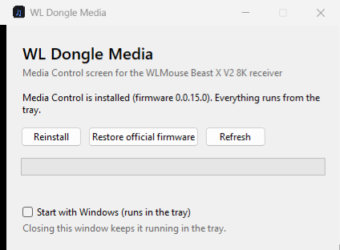

# WL Dongle Media

**A media-control screen for the touch display on the WLMouse Beast X V2 8K receiver.**
Play/pause, skip tracks, change the volume, switch audio outputs, mute your mic and mix app
volumes, right from the little screen on your mouse dongle.

> Unofficial community project. Not affiliated with or endorsed by WLMouse.
> Flashing firmware always carries some risk: read [Safety](#safety) first.

<!-- photos of the AUDIO and MIXER screens coming soon
| AUDIO | MIXER |
|---|---|
|  |  |
-->

## Features

**AUDIO screen**
- Current Spotify song with a ♪ icon. Long titles scroll; it's empty when Spotify is closed.
- Previous / play-pause / next. The play-pause icon follows what Spotify is really doing.
- Master volume − / +.
- Current audio output (speakers, headphones, monitor…). Tap it to switch to the next connected output.
- Microphone mute button.
- Mouse battery with percentage.
- The dongle no longer drops to its sleep screen while you're on this screen, so the buttons always respond.

**MIXER screen**
- Volume for each app that's playing sound, in 2 % steps. Spotify is selected by default.
- ◀ ▶ switch between apps; tap the app name to mute or unmute it.
- Volume bar and percentage.

**Everywhere else**
- "Media Control" becomes a fourth *Default Screen*, saved on the dongle.
- Small icons jump between the stock *Media* (picture) screen and Media Control, and between AUDIO and MIXER.
- Double-tap (if *Double Touch Link* is on) plays/pauses instead of opening the WLMouse website.

The screens live on the dongle itself. The buttons and live info (song, outputs, apps, mic) come
from the small **WL Dongle Media** app, which runs in the system tray.



## Requirements

- Windows 10 or 11.
- WLMouse **Beast X V2** with its **8K receiver** (the one with the screen), receiver firmware **0.0.15.0**.
- Internet the first time you install (to download the official firmware, see below).
- Close **WL MOUSE HUB** and the WLMouse web driver while installing.

## Install

1. Download **`WLDongleMedia.exe`** from [Releases](../../releases/latest).
2. Run it. Windows SmartScreen may say *"Windows protected your PC"* because the exe isn't code-signed:
   click **More info → Run anyway** (or [run it from source](#run-from-source)).
3. Click **Install Media Control** and wait. It takes **10-20 minutes**; don't unplug the dongle.
4. Done. Media Control is now the default screen, and the app starts with Windows in the tray.

To go back to stock, open the app and click **Restore official firmware**.

## Safety

- **No WLMouse files are included.** The app downloads the official screen firmware from WLMouse's
  own server (`gm.wlmouse.gg`, the same file their web driver uses), checks its SHA-256, and only
  continues if it's exactly v0.0.15.0. It then applies this project's patch
  ([`src/patch_v6.json`](src/patch_v6.json), ~40 KB of our own code) and checks the result's SHA-256 too.
- **Only the screen chip is touched.** The receiver has two chips: an nRF54LM20 that handles USB and
  the mouse link, and an MH2435 that drives the screen. This tool only flashes the MH2435 and never
  touches the USB chip, so the receiver keeps working as a receiver no matter what.
- **Every byte is verified.** Each 496-byte block is echoed back by the dongle before moving on, and
  the whole image is read back and compared at the end.
- **If something goes wrong** before the erase step (e.g. the dongle doesn't enter update mode),
  nothing changes. If it fails mid-flash, the screen stays in update mode: run the install again, or
  use **Restore official firmware** (or WLMouse's official web driver).

## Verify the download

- **Built by GitHub, not on someone's PC:** the exe is built from the tagged source by
  [this workflow](.github/workflows/release.yml) and published with a signed build-provenance
  attestation. Check it with the [GitHub CLI](https://cli.github.com/):
  ```
  gh attestation verify WLDongleMedia.exe --repo matijuguera/wl-dongle-media
  ```
- **Checksum:** compare with `SHA256SUMS.txt` from the release:
  ```
  certutil -hashfile WLDongleMedia.exe SHA256
  ```

## Run from source

```
pip install -r requirements.txt
python src/app.py
```

`python src/installer.py --status` shows what the dongle has; `python src/installer.py` installs
from the command line; `python src/installer.py --restore` goes back to stock.

## How it works

| Direction | Channel | What |
|---|---|---|
| Dongle → PC | vendor HID input report `04 CD <code>` (usage page 0xFFA0) | button presses |
| PC → dongle | 512-byte feature report, interface 3, LCD command `0x20` | 208-byte block with the texts and states to draw |
| PC → dongle | same channel, bootloader commands `B0 01/0D/8E/04` | firmware update (`src/flasher.py`) |

The firmware patch is generated by [`firmware/`](firmware/): a small Thumb-2 assembler where every
new instruction is checked by disassembling it with Capstone, plus hooks into the stock LVGL UI. To
rebuild it you need the official hex in `backup-original/` (not included); see
[`firmware/README.md`](firmware/README.md).

## Limitations

- Windows only for now (the dongle part is OS-independent; the tray app uses Windows audio APIs).
- Song name and play state come from Spotify only.
- Only receiver firmware 0.0.15.0 is supported. If WLMouse ships a new firmware, the installer
  refuses to patch it until the patch is updated.

## License

[MIT](LICENSE). WLMouse and Beast X are trademarks of their owners.
